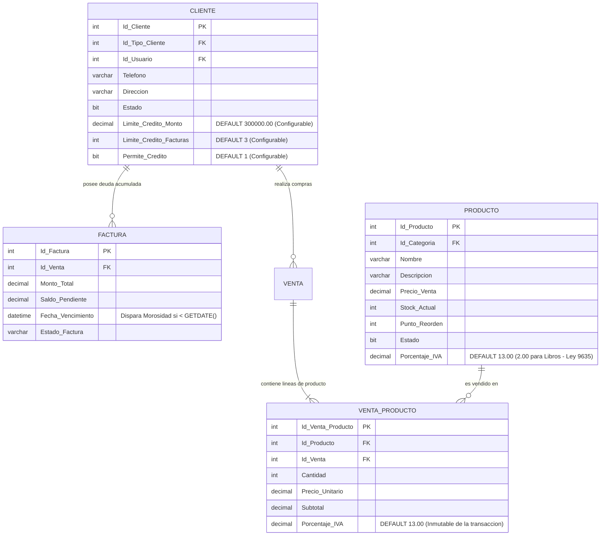

# DOCUMENTO TÉCNICO DE ACTUALIZACIÓN ARQUITECTURAL: RÉGIMEN DE IVA DIFERENCIADO (LEY 9635), UMBRALES DE CRÉDITO COMERCIAL Y POLÍTICA DE MOROSIDAD ENDURECIDA
## Sistema de Información — Librería y Papelería Mundo Escolar S.A.

> **Documento Oficial de Especificación y Diccionario de Datos &bull; Noviembre 2026**  
> **Autores / Equipo de Desarrollo:** Mauricio Chavarría & Samir Campos  
> **Plataforma:** Microsoft SQL Server 2022 &bull; NestJS 11 &bull; React 18 / Vite  
> **Ámbito de Aplicación:** 100% Local (Servidor `localhost:1433/MUNDO_ESCOLAR`)  
> **Estado de Despliegue:** Implementado y Verificado Localmente (Sin subida a Git Remote)  

---

## 1. Justificación y Fundamentación de Negocio

El sistema comercial y contable de *Mundo Escolar* ha sido fortalecido con tres pilares funcionales y normativos críticos para el mercado costarricense:

### 1.1. Régimen de IVA Diferenciado — Ley N.° 9635 (Fortalecimiento de las Finanzas Públicas de Costa Rica)
* **Marco Legal:** Conforme al Artículo 11 de la Ley N.° 9635 y su reglamento, los libros de texto escolar y las obras literarias/educativas gozan de una **tarifa reducida del 2%** en el Impuesto sobre el Valor Agregado (IVA), en contraposición a la tarifa general del **13%** que aplica a los suministros de papelería, tecnología y servicios generales.
* **Implementación:** Se incorpora el atributo `Porcentaje_IVA` tanto a nivel de catálogo de producto (`dbo.Producto`) como a nivel transaccional en el detalle histórico de ventas (`dbo.Venta_Producto`). El cálculo impositivo del motor SQL (`SP_Venta_CalcularTotales`), backend y frontend liquida el impuesto línea por línea en lugar de aplicar un factor global fijo.

### 1.2. Umbrales Comerciales y Capacidad de Crédito Configurable (15, 30 y 45 Días)
* **Problemática Resuelta:** Previamente, el sistema solo disponía de la autorización binaria de crédito sin límite de endeudamiento o cantidad de facturas activas, lo que generaba un riesgo crediticio no mitigado.
* **Solución Implementada:** Se establecen parámetros comerciales **configurables por cliente** en `dbo.Cliente`:
  - `Limite_Credito_Monto` (Tope de saldo acumulado adeudado, por defecto ₡300.000,00).
  - `Limite_Credito_Facturas` (Tope de compras/facturas a crédito simultáneas activas, por defecto 3).
  - `Permite_Credito` (Bandera booleana de habilitación de crédito comercial).
* **Control Transaccional:** Se implementa el procedimiento `SP_Cliente_ValidarCapacidadCredito` invocado de forma automática e inviolable al crear (`SP_Venta_Crear`) y al confirmar (`SP_Venta_Confirmar`) ventas en el sistema.

### 1.3. Política Endurecida de Morosidad (Bloqueo Total)
* **Regla Comercial Endurecida:** Si un cliente mantiene una o más facturas con saldo pendiente (`Saldo_Pendiente > 0.00`) cuya fecha de vencimiento haya expirado (`Fecha_Vencimiento < GETDATE()`), el cliente es clasificado inmediatamente en estado **MOROSO**.
* **Efecto Operativo:** Se bloquea **terminantemente cualquier nueva transacción de venta: NI A CRÉDITO NI DE CONTADO**. El cliente no puede realizar compras hasta que acuda al módulo de Facturación / Cuentas por Cobrar a liquidar sus saldos en mora.
* **Reflexión sobre el ciclo de mora:** Si un cliente adquiere a crédito con plazo de 15, 30 o 45 días y no abona al vencer la fecha de pago:
  1. Su estado transaccional en la vista `VW_ClientesActivos` y en el endpoint `GET /clientes/:id/estado-credito` conmuta automáticamente a `Es_Moroso = true`.
  2. En el Punto de Venta (POS), el cajero recibe un banner visual de alerta roja permanente y el botón de cobro se deshabilita por completo.
  3. A nivel de base de datos, cualquier intento de forzar la venta dispara la excepción `50182: Operación bloqueada: El cliente presenta facturas vencidas en estado MOROSO...`.

---

## 2. Actualización del Modelo Entidad-Relación (MER)



---

## 3. Actualización del Diccionario de Datos

### 3.1. Entidad `dbo.Cliente` (Ampliación de Columnas)

| Campo | Tipo de Dato | Nulable | Valor por Defecto | Restricción / Integridad | Descripción Técnica y Semántica |
| :--- | :--- | :--- | :--- | :--- | :--- |
| `Limite_Credito_Monto` | `DECIMAL(12,2)` | NO | `300000.00` | `CHECK (Limite_Credito_Monto >= 0.00)` | Monto máximo en colones costarricenses (CRC) de deuda acumulada que el cliente puede mantener en facturas activas. Es parametrizable por cliente en el panel administrativo. |
| `Limite_Credito_Facturas` | `INT` | NO | `3` | `CHECK (Limite_Credito_Facturas >= 1)` | Cantidad máxima de compras o facturas a crédito activas que el cliente puede sostener de forma simultánea sin haberlas liquidado. |
| `Permite_Credito` | `BIT` | NO | `1` | Booleano `0` o `1` | Bandera de autorización comercial para transaccionar a crédito (15, 30 o 45 días). Si es `0`, el cliente únicamente opera en modalidad de contado. |

### 3.2. Entidad `dbo.Producto` (Ampliación de Columnas)

| Campo | Tipo de Dato | Nulable | Valor por Defecto | Restricción / Integridad | Descripción Técnica y Semántica |
| :--- | :--- | :--- | :--- | :--- | :--- |
| `Porcentaje_IVA` | `DECIMAL(5,2)` | NO | `13.00` | `CHECK (Porcentaje_IVA IN (0.00, 1.00, 2.00, 4.00, 13.00))` | Porcentaje de Impuesto sobre el Valor Agregado gravado al producto. Tarifa del 2.00% asignada a libros escolares y didácticos (Ley 9635 de Costa Rica) y 13.00% para suministros generales. |

### 3.3. Entidad `dbo.Venta_Producto` (Ampliación de Columnas)

| Campo | Tipo de Dato | Nulable | Valor por Defecto | Restricción / Integridad | Descripción Técnica y Semántica |
| :--- | :--- | :--- | :--- | :--- | :--- |
| `Porcentaje_IVA` | `DECIMAL(5,2)` | NO | `13.00` | Copia inmutable histórica | Porcentaje de IVA vigente en el momento exacto en que se consolidó la venta. Garantiza la inmutabilidad tributaria histórica ante eventuales reformas impositivas. |

### 3.4. Vista `dbo.VW_ClientesActivos` (Atributos Expuestos)

* `Es_Moroso (BIT)`: Columna calculada en tiempo real. Retorna `1` si existe al menos una factura con `Saldo_Pendiente > 0.00` y `Fecha_Vencimiento < GETDATE()`; retorna `0` en caso contrario.
* `Limite_Credito_Monto (DECIMAL(12,2))`: Tope de crédito autorizado.
* `Limite_Credito_Facturas (INT)`: Facturas simultáneas autorizadas.
* `Permite_Credito (BIT)`: Habilitación de crédito comercial.

---

## 4. Inventario Oficial y Consolidado de Stored Procedures

Para responder de forma definitiva a las dudas del equipo y de Samir respecto al número de procedimientos documentados:

```
Total Procedimientos Almacenados en el Sistema: 105
├── Procedimientos Base y Operativos (Hito #2 Original): 96 SPs
│   ├── SP 1 al 13: Clientes, Contactos, Proveedores y Categorías
│   ├── SP 14 al 24: Kárdex, Inventario, Compras y Proveedores
│   ├── SP 25 al 37: Clientes y Condiciones de Pago (15, 30, 45 días)
│   ├── SP 38 al 50: Ventas, Facturación, Abonos y Pagos
│   ├── SP 51 al 60: Usuarios, Roles, Autenticación y Auditoría
│   ├── SP 61 al 80: Mantenimiento DBA, Integridad y Respaldos
│   └── SP 81 al 96: ETL y Data Warehouse Constelación
├── Procedimientos de Remediación de Seguridad y PoLP (Auditoría): 8 SPs
│   ├── SP_Usuario_VerificarDisponibilidad (Validación de unicidad sin SELECT directo a Usuario)
│   ├── SP_Usuario_ActualizarCorreo (Actualización de correo bajo PoLP)
│   ├── SP_DBA_ConsultarHistorialBackups (Consulta del catálogo de respaldos para rol_db_aplicacion)
│   ├── SP_DBA_GenerarBackupTotal (Con compresión condicional y sin usuario 1 fijo)
│   ├── SP_DBA_GenerarBackupDiferencial (Con compresión condicional)
│   ├── SP_DBA_GenerarBackupLog (Con compresión condicional)
│   ├── SP_DBA_ProbarRestauracionAislada (Restauración de prueba automatizada)
│   └── SP_Auth_InvalidarTokenSesion (Persistencia de tokens revocados)
└── Procedimientos Nuevos de Capacidad Crediticia y Morosidad: 2 SPs
    ├── 37B. SP_Cliente_ValidarCapacidadCredito (Validación transaccional de umbrales y morosidad)
    └── 37C. SP_Cliente_ConsultarEstadoCredito (Consulta segura de estado crediticio bajo PoLP)
```

**Conclusión:** Los 96 procedimientos documentados en la entrega original de Hito #2 **se encuentran al 100% implementados y vigentes**. La diferencia numérica obedece a los procedimientos especializados agregados para cumplir las observaciones de auditoría de Samir (PoLP) y la presente política de crédito/morosidad, elevando el catálogo total a **105 procedimientos almacenados**.

---

## 5. Resumen de Pruebas Automatizadas y Compilación

1. **Frontend (Vite / React 18):** `npm run build` ejecutado exitosamente con 0 advertencias de sintaxis y generación limpia de artefactos en `frontend/dist`.
2. **Backend (NestJS 11):** `npm run build` (`nest build`) compilado con código de salida 0.
3. **Pruebas Unitarias:** 2 de 2 pruebas unitarias pasando (`app.controller.spec.ts`).
4. **Pruebas de Integración E2E:** 10 de 10 pruebas pasando (`app.e2e-spec.ts`), incluyendo la comprobación del endpoint `GET /clientes/:id/estado-credito` y la validación de unicidad bajo PoLP.
5. **Entorno de Trabajo:** Todos los cambios se mantienen estrictamente locales en la rama `Feature-Mau`. Ningún commit ni push remoto ha sido emitido.

