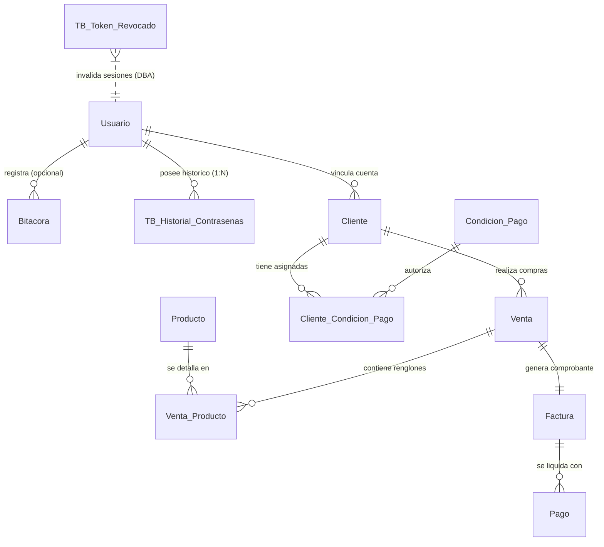

# GUÍA TÉCNICA DE ACTUALIZACIONES DOCUMENTALES (POST-HITO #2)
## Manual Práctico para la Actualización del Modelo Conceptual (MC), Modelo Entidad-Relación (MER), Normalización y Diccionario de Datos

**Proyecto:** Sistema de Información Integral — Librería y Papelería Mundo Escolar (Liberia, Guanacaste)  
**Autores / Tesistas:** Mauricio Chavarría & Samir Campos Díaz (Desarrolladores Líderes)  
**Evaluador / Tutor:** Lic. / Prof. Torrentes — Bases de Datos Avanzadas e Inteligencia de Negocios  
**Fecha & Versión:** 4 de Noviembre de 2026 · Versión 2.4 Oficial de Documentación  
**Archivos PDF Oficiales Generados:**
- [Guia_Actualizaciones_MC_MER_Normalizacion_Diccionario.pdf](file:///C:/MUNDO_ESCOLAR/Guia_Actualizaciones_MC_MER_Normalizacion_Diccionario.pdf)
- [docs/Guia_Actualizaciones_MC_MER_Normalizacion_Diccionario.pdf](file:///C:/MUNDO_ESCOLAR/docs/Guia_Actualizaciones_MC_MER_Normalizacion_Diccionario.pdf)

---

## 1. Actualizaciones en el Modelo Conceptual (MC)

El **Modelo Conceptual** representa los conceptos esenciales y las reglas del dominio del negocio de *Librería y Papelería Mundo Escolar* en el más alto nivel de abstracción (espacio del problema).

### 1.1. Conceptos del Negocio que SÍ se Actualizan en el MC
- **Cliente:**
  - *Límite de Monto de Crédito:* Monto máximo en colones financiado a clientes o centros educativos.
  - *Límite de Facturas a Crédito:* Cantidad máxima de compras a crédito simultáneas permitidas.
  - *Autorización de Crédito:* Bandera comercial de autorización para ventas a 15, 30 o 45 días.
- **Producto:**
  - *Tasa Impositiva de IVA:* Clasificación fiscal del artículo según Ley 9635 (2% libros escolares, 13% suministros generales, 0% exento).
- **Factura:**
  - *Clave Numérica Fiscal:* Código tributario de 50 dígitos exigido por la DGT para comprobantes electrónicos.
- **Bitácora:**
  - *Actor Responsable (Opcional):* Permite registrar tanto acciones de usuarios como eventos de autoservicio anónimos.

### 1.2. Lo que NO debe incluirse en el Modelo Conceptual (Error a Evitar)
> **Advertencia Metodológica:** Las tablas técnicas `TB_Historial_Contrasenas` y `TB_Token_Revocado` **NO deben incluirse en el Modelo Conceptual**. Pertenecen a la arquitectura de software y seguridad criptográfica, no al dominio del negocio de una librería.

---

## 2. Actualizaciones en el Modelo Entidad-Relación (MER)

### 2.1. Atributos Nuevos por Entidad Canónica (MER Lógico)
- **`Usuario`:** Añadir atributo simple `Requiere_Cambio_Contrasena (Booleano)`. Default: Falso.
- **`Bitacora`:** Modificar cardinalidad de relación con `Usuario`: pasa de $1 \rightarrow N$ obligatoria a **$0..1 \rightarrow 0..N$ opcional**.
- **`Cliente`:** Añadir `Limite_Credito_Monto (Decimal)`, `Limite_Credito_Facturas (Entero)` y `Permite_Credito (Booleano)`.
- **`Producto`:** Añadir `Porcentaje_IVA (Decimal)`.
- **`Venta_Producto`:** Añadir `Porcentaje_IVA (Decimal)` como atributo del renglón de venta (snapshot histórico).
- **`Factura`:** Añadir `Clave_Numerica_Fiscal (Alfanumérico 50 dígitos)`.

### 2.2. Diagrama Entidad-Relación (Mermaid)

### 2.3. Incorporación en el DER Físico (Anexo de Seguridad)
En el diagrama físico generado desde SQL Server Management Studio, incluir un recuadro anexo titulado:
> **"Subsistema de Soporte DBA y Criptografía de Sesiones"**  
> - `TB_Historial_Contrasenas`: Relación $1:N$ con `dbo.Usuario(Id_Usuario)`.  
> - `TB_Token_Revocado`: Entidad técnica independiente para la lista negra de JWT en logout.

---

## 3. Actualizaciones en el Documento de Normalización (3FN)

### 3.1. Demostración de la Primera Forma Normal (1FN) mediante `TB_Historial_Contrasenas`
- **Problema de diseño sin tabla técnica:** Si guardáramos las contraseñas anteriores dentro de `dbo.Usuario` (`Clave_Ant1`, `Clave_Ant2`, etc.), estaríamos introduciendo **grupos repetitivos y atributos multivaluados**, lo cual **viola la 1FN**.
- **Solución formal de 1FN:** Se extrae el atributo multivaluado a la relación `TB_Historial_Contrasenas (Id_Historial, Id_Usuario, Contrasena_Hash, Fecha_Modificacion)` vinculada por FK. Cada celda contiene un valor estrictamente atómico.

### 3.2. Verificación de 2FN y 3FN en Entidades Modificadas
- **`Cliente`:** Clave primaria simple (`Id_Cliente`). Dependencia funcional completa (2FN). Los atributos de crédito no determinan atributos no clave entre sí (3FN).
- **`Producto`:** Clave primaria simple (`Id_Producto`). `Porcentaje_IVA` depende exclusivamente del producto en catálogo (2FN y 3FN).
- **`Venta_Producto`:** Clave primaria compuesta `(Id_Venta, Id_Producto)`. `Porcentaje_IVA` depende del producto vendido en esa venta específica en su fecha de emisión (inmutabilidad histórica). Cumple 2FN y 3FN sin dependencias transitivas.
- **`Factura`:** `Clave_Numerica_Fiscal` depende exclusivamente de `Id_Factura` (2FN y 3FN).

---

## 4. Diccionario de Datos: Especificación Lista para Copiar

### 4.1. `dbo.Cliente` (Atributos de Crédito y Morosidad)
| Campo | Tipo de Dato | Nulo | Default | Restricción | Descripción Semántica |
| :--- | :--- | :---: | :--- | :--- | :--- |
| `Limite_Credito_Monto` | `DECIMAL(12,2)` | NO | `300000.00` | `CHECK (>= 0.00)` | Monto máximo de deuda en colones (CRC) permitido en facturas pendientes. |
| `Limite_Credito_Facturas` | `INT` | NO | `3` | `CHECK (>= 1)` | Cantidad máxima de facturas a crédito simultáneas autorizadas. |
| `Permite_Credito` | `BIT` | NO | `1` | `CHECK (IN (0,1))` | `1` habilita compras a crédito (15, 30, 45 días); `0` restringe a contado. |

### 4.2. `dbo.Producto` (Tasa Tributaria Ley 9635)
| Campo | Tipo de Dato | Nulo | Default | Restricción | Descripción Semántica |
| :--- | :--- | :---: | :--- | :--- | :--- |
| `Porcentaje_IVA` | `DECIMAL(5,2)` | NO | `13.00` | `CHECK (>= 0.00)` | Porcentaje de IVA gravado al producto en catálogo (0%, 1%, 2% o 13%). |

### 4.3. `dbo.Venta_Producto` (Tasa Histórica Inmutable)
| Campo | Tipo de Dato | Nulo | Default | Restricción | Descripción Semántica |
| :--- | :--- | :---: | :--- | :--- | :--- |
| `Porcentaje_IVA` | `DECIMAL(5,2)` | NO | `13.00` | Snapshot Histórico | Tasa de IVA aplicada al momento exacto de la venta (inmutable). |

### 4.4. `dbo.Factura` (Clave Fiscal Electrónica DGT)
| Campo | Tipo de Dato | Nulo | Default | Restricción | Descripción Semántica |
| :--- | :--- | :---: | :--- | :--- | :--- |
| `Clave_Numerica_Fiscal` | `VARCHAR(50)` | SÍ | `NULL` | DGT-R-033-2019 | Código fiscal de 50 dígitos para factura electrónica y QR de 80mm. |

### 4.5. `dbo.Usuario` (Seguridad de Primer Ingreso)
| Campo | Tipo de Dato | Nulo | Default | Restricción | Descripción Semántica |
| :--- | :--- | :---: | :--- | :--- | :--- |
| `Requiere_Cambio_Contrasena` | `BIT` | NO | `0` | `CHECK (IN (0,1))` | `1` obliga al usuario a redefinir su clave temporal en el primer ingreso. |

---

## 5. Diccionario de Datos: Tablas Técnicas de Soporte DBA

### 5.1. `dbo.TB_Historial_Contrasenas`
*Descripción:* Almacena los hashes de contraseñas de los usuarios para auditoría y no reutilización de claves (Remediación S03).
| Campo | Tipo de Dato | Nulo | Clave | Integridad / FK | Descripción |
| :--- | :--- | :---: | :---: | :--- | :--- |
| `Id_Historial` | `INT` | NO | PK | `IDENTITY(1,1)` | Identificador autonumérico del registro histórico. |
| `Id_Usuario` | `INT` | NO | FK | Ref: `Usuario(Id_Usuario)` | Usuario propietario de la contraseña histórica. |
| `Contrasena_Hash` | `VARCHAR(255)` | NO | - | Hash bcrypt / argon2id | Hash criptográfico salado de la clave anterior. |
| `Fecha_Modificacion` | `DATETIME` | NO | - | `DEFAULT GETDATE()` | Fecha y hora en que se cambió la contraseña. |

### 5.2. `dbo.TB_Token_Revocado`
*Descripción:* Lista negra persistente en base de datos para revocación inmediata de tokens JWT en logout (Remediación S08).
| Campo | Tipo de Dato | Nulo | Clave | Integridad / Índices | Descripción |
| :--- | :--- | :---: | :---: | :--- | :--- |
| `Id_Token` | `INT` | NO | PK | `IDENTITY(1,1)` | Identificador autonumérico del token revocado. |
| `Token_Hash` | `VARCHAR(64)` | NO | UQ | Índice único SHA-256 | Firma criptográfica del token para búsqueda $O(1)$. |
| `Fecha_Expiracion` | `DATETIME` | NO | - | Vigencia Natural JWT | Momento en que el token habría expirado (TTL de purga). |
| `Fecha_Revocacion` | `DATETIME` | NO | - | `DEFAULT GETDATE()` | Timestamp del logout que invalidó la sesión. |

---

## 6. Checklist de Tareas para la Tesis

- [ ] **Capítulo 3 (MC):** Agregar al concepto *Cliente* los parámetros de crédito; al concepto *Producto* el IVA; a *Factura* la clave fiscal. Excluir tablas de tokens y hashes.
- [ ] **Capítulo 4 (MER Lógico):** Reflejar los nuevos atributos en las 33 entidades y cambiar cardinalidad de `Bitacora` a opcional.
- [ ] **Capítulo 4 (DER Físico):** Añadir anexo con `TB_Historial_Contrasenas` ($1:N$) y `TB_Token_Revocado`.
- [ ] **Capítulo 5 (Normalización):** Incluir la justificación formal de la **1FN** mediante la tabla técnica de historial de contraseñas.
- [ ] **Capítulo 6 (Diccionario de Datos):** Pegar las fichas técnicas formateadas de las Secciones 4 y 5.

